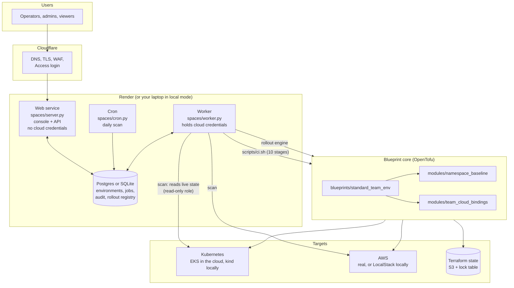

# 00 System overview

**Status: built and validated locally (kind + LocalStack, SQLite and Postgres, Docker). The Render and Cloudflare deployment is written and tested locally but has never run. No company uses it yet. Local results are not adoption evidence.**

Related utility model: German Utility Model No. 20 2025 107 185, "System for Blueprinted Platform Engineering using Terraform Modules on Kubernetes/Openshift with CI/CD". This build is aligned with the **title** only. The claims text was never supplied. Describe it as "a reference implementation aligned with the title", never as an implementation of the claims. See `docs/patent-alignment.md`.

## What the system is

A platform team keeps one standard environment definition (a **blueprint**) built from reusable **Terraform/OpenTofu modules**. A **CI/CD pipeline** turns a small request file into a ready, guard-railed environment. Products on top of that:

| Layer | What it does | Document |
|---|---|---|
| Blueprint and modules | Defines what a standard environment is | [01](01-blueprint-and-modules.md) |
| Delivery pipeline | Request file in, verified environment out | [02](02-delivery-pipeline.md) |
| Compliance-Ready Spaces | Console and API: request an environment, check it with 14 baseline controls and 42 extended checks | [03](03-compliance-spaces.md) |
| Blueprint Rollout Manager | Move many environments to a new blueprint version safely | [04](04-rollout-manager.md) |
| Local environment and testing | kind + LocalStack, test layers, validation runs | [05](05-local-environment-and-testing.md) |
| Cloud deployment | Render, Cloudflare, AWS, EKS: components, decisions, failure behaviour | [06](06-cloud-deployment.md) |

Lookup tables (settings, API, roles, jobs, commands): [`docs/reference.md`](../reference.md). Handoff for whoever takes this over: [`docs/HANDOFF.md`](../HANDOFF.md).

## System architecture

Reading the diagram: the web service only validates, authorises and queues. The worker does everything that touches a cluster or AWS. The pipeline and the rollout manager both end in `tofu apply` against the same blueprint, and the rollout manager reuses the checker as its verification step, so the 14 baseline controls are the single definition of "this environment is healthy".

Locally the same code runs on one machine: SQLite instead of Postgres, the worker as a thread in the web process, LocalStack and kind instead of AWS and EKS, and no login.

## One environment: what gets created

One apply creates 20 resources:

| Layer | Resources |
|---|---|
| Kubernetes | Namespace with ownership labels; resource quota (CPU, memory, pods, storage, PVC count, ingress count); limit range; network policies (default-deny, same-namespace, ingress controller, optional allow-list); role bindings for named admin groups |
| AWS | S3 bucket (private, versioned, encrypted); SQS queue (encrypted); Secrets Manager secret; CloudWatch log group with retention; IAM role (with a permissions boundary in real AWS) and policy limited to those resources |
| Binding | ServiceAccount `app` annotated with the role ARN; ConfigMap `cloud-resources` with bucket, queue URL, secret name, log group, role ARN |

## Where state lives

| State | Location | Notes |
|---|---|---|
| Infrastructure state | S3 bucket with a DynamoDB lock table (LocalStack locally), one key per environment (`<name>.tfstate`; `rollout/<name>.tfstate` for the rollout manager) | Created by `local/bootstrap` locally, `deploy/aws/bootstrap` in AWS |
| Environments, scan history (last 30), jobs, audit log, rollout registry and runs | Shared database: Postgres (Render) or SQLite `.local/platform.db` | Web, worker and cron are separate processes and share only this |
| Pipeline metrics | LocalStack bucket locally; `metric` records in the database in the cloud | Written by `scripts/record_metric.py` |
| Rollout work dirs, plugin cache, catalog clone | `.local/rollout/` (or `/opt/tf-plugins` in the image) | Disposable |
| Local kubeconfig | `.local/kubeconfig` | Never touches `~/.kube/config` |

`.local/` is disposable. `make down` removes the cluster, LocalStack and local files.

## Design decisions

1. **Standards live in versioned code.** A change to the standard is a new blueprint version (a git tag).
2. **Secure defaults.** Default-deny ingress, a quota on every namespace, no cluster-wide admin.
3. **Sizes, not free-form settings.** small, medium, large presets keep environments consistent.
4. **One checker, two uses.** The same 14 baseline controls power the compliance report and rollout verification. The 42 extended checks add findings but never change `compliant`.
5. **Pure logic separated from side effects.** `controls.evaluate`, `checks.evaluate` and `rollout/core.run_rollout` are pure over a snapshot or an engine, so they are unit tested without a cluster.
6. **The public service has no cloud credentials.** Only the worker has them, through an assume-only user and scoped roles. See [06](06-cloud-deployment.md).
7. **The app verifies login itself.** Cloudflare Access tokens are checked in the app, so the plain Render address is useless without one.
8. **Same code locally and in the cloud.** Mode switches (`PLATFORM_MODE`, `AUTH_MODE`) choose the stand-ins; tests need no account.

## Trust boundaries and what is not covered

- Nothing has run on real AWS, EKS, Render or Cloudflare. The IAM policies have never met real IAM.
- LocalStack does **not** enforce IAM. IAM policies are checked by content only.
- Permissions are by role, not by team. A viewer sees every environment.
- The 14 controls and 42 checks are engineering choices by the author. They are not mapped to CIS, SOC 2 or ISO.
- GitHub Actions workflows are written, not run. The company's real pipeline credentials and state backend are not defined.

## Technology

OpenTofu 1.13.2 (kubernetes and aws providers), Kubernetes 1.31.2 via kind locally (Colima for Docker), kubectl 1.33 and AWS CLI 2.17 in the image, LocalStack 3.8, Python 3 (standard library for server, collector and rollout; `cryptography` for token verification; `psycopg` for Postgres), Postgres 16, pytest, bash, Docker, Render, Cloudflare Access, GitHub Actions (written, not run).
