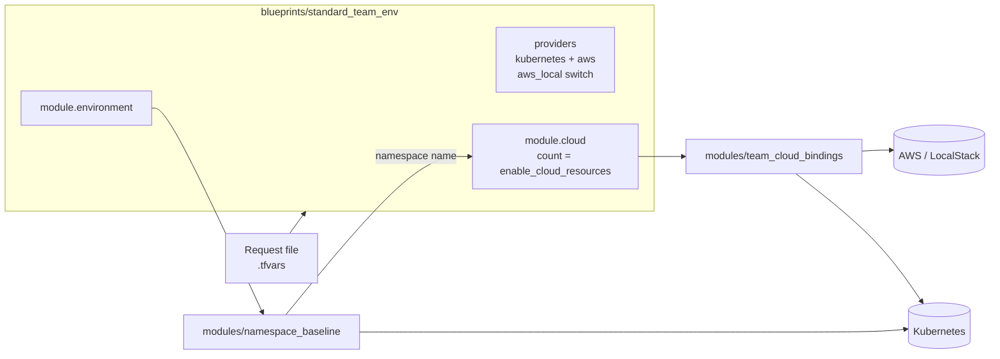
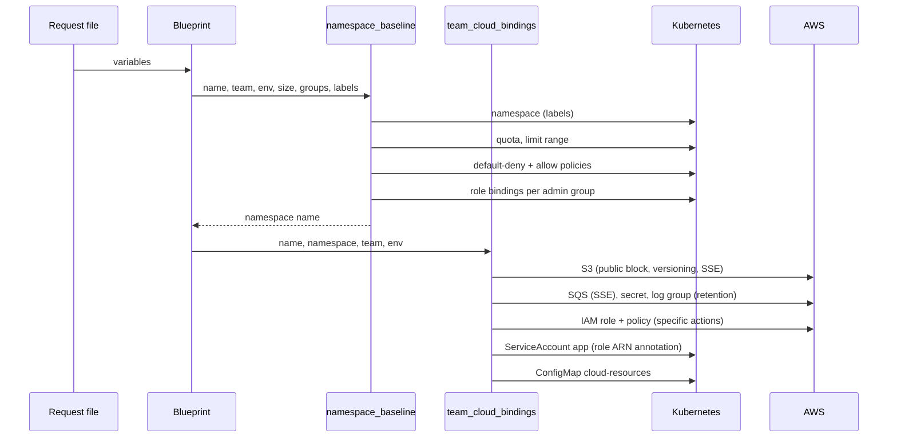

# 01 Blueprint and modules

**Status: built; 19 module tests pass (13 baseline, 6 cloud).**

This is the part that corresponds to "Terraform modules" and "blueprinted platform engineering" in the utility model title.

## Architecture

| Path | Role |
|---|---|
| `blueprints/standard_team_env/` | Composes both modules; holds provider config and the request variables |
| `modules/namespace_baseline/` | Namespace, quota, limit range, network policies, role bindings |
| `modules/team_cloud_bindings/` | S3, SQS, secret, log group, IAM role and policy, ServiceAccount, ConfigMap |
| `modules/*/tests/` | `tofu test` suites using mocked providers |

## Inputs (the request)

| Variable | Meaning | Default |
|---|---|---|
| `name` | Namespace and resource prefix (for example `team-alpha-dev`) | required |
| `team`, `environment` | Ownership labels (`curve-metrics/team`, `curve-metrics/environment`) | required |
| `size` | `small`, `medium`, `large` | `small` |
| `admin_groups` | Groups bound to the `admin` ClusterRole inside the namespace | `[]` |
| `allow_ingress_from_namespaces` | Extra namespaces allowed to reach the workloads | `[]` |
| `allow_ingress_controller`, `ingress_controller_namespace` | Allow the cluster ingress controller (for example `openshift-ingress`) | true, `ingress-nginx` |
| `extra_labels` | Added to the namespace (the rollout manager uses it for the version label) | `{}` |
| `enable_cloud_resources` | Also create the AWS resources and bindings | true |
| `aws_local`, `aws_endpoint` | Point the AWS provider at LocalStack | false |
| `aws_region` | Region for the AWS provider | `us-east-1` |
| `oidc_provider_arn`, `oidc_issuer` | The cluster's OIDC identity for the IAM role trust policy. Null keeps a local placeholder. Real AWS needs both | null |
| `permissions_boundary_arn` | Boundary attached to the application role. Null means none; set it in real AWS | null |

## Size presets

| Size | CPU req/limit | Memory req/limit | Pods | Storage | PVCs | Ingresses |
|---|---|---|---|---|---|---|
| small | 2 / 4 | 4Gi / 8Gi | 20 | 50Gi | 5 | 3 |
| medium | 4 / 8 | 8Gi / 16Gi | 50 | 200Gi | 10 | 5 |
| large | 8 / 16 | 16Gi / 32Gi | 100 | 500Gi | 20 | 10 |

The presets exist in two places: `modules/namespace_baseline/main.tf` and `SIZE_PRESETS` in `spaces/controls.py`. A unit test fails if they drift apart. Change both together.

## Flow: how a request becomes resources

## Network policy model

Policies are additive allows on top of a default deny:

1. `default-deny-ingress`: selects all pods, no allow rules.
2. `allow-same-namespace`: pods in the namespace talk to each other.
3. `allow-ingress-controller` (if enabled): the ingress controller namespace.
4. `allow-listed-namespaces` (if the list is not empty): one rule per listed namespace.

Role binding names are `team-admin-<8 chars of sha1(group)>`, so they are stable per group.

## AWS resource conventions

Names derive from `name`: `<name>-data` (bucket), `<name>-events` (queue), `<name>/app` (secret), `/curve-metrics/<name>` (log group), `<name>-app` (role and policy). The IAM trust policy is a web-identity statement built from `oidc_provider_arn` and `oidc_issuer`. With LocalStack it uses a placeholder; it only works for real with a cluster OIDC provider (EKS), which `deploy/README.md` describes. In real AWS the role carries `permissions_boundary_arn`, so even a flawed policy cannot grant more than the boundary allows. Log retention is `log_retention_days` (30 by default).

## Known limits

- OpenShift-specific objects (Projects, SCCs, Routes) are not created or tested. Kubernetes alone satisfies the title.
- IRSA (real IAM roles for service accounts) is untested, since EKS is not emulated. The wiring for real AWS (OIDC variables, permissions boundary) exists and is covered by a module test, but has never run against real AWS.
- A default storage class is cluster-specific and not set.
