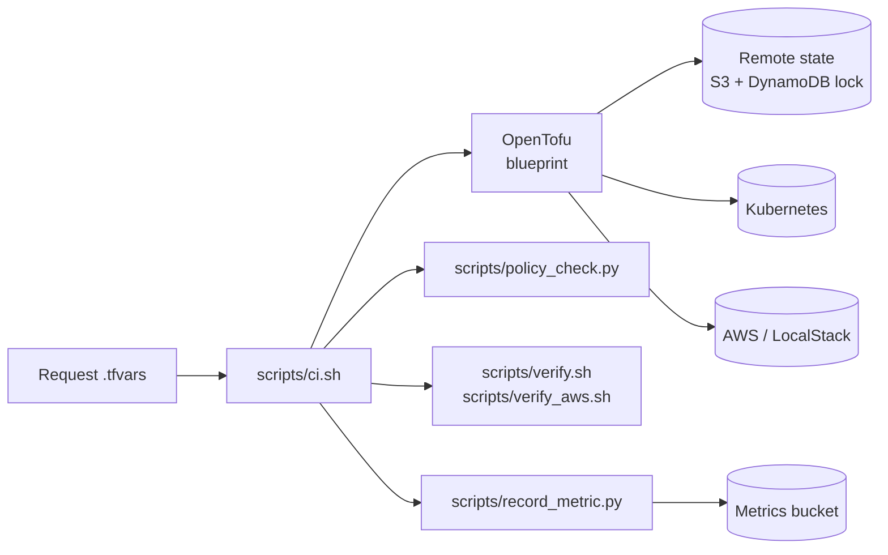
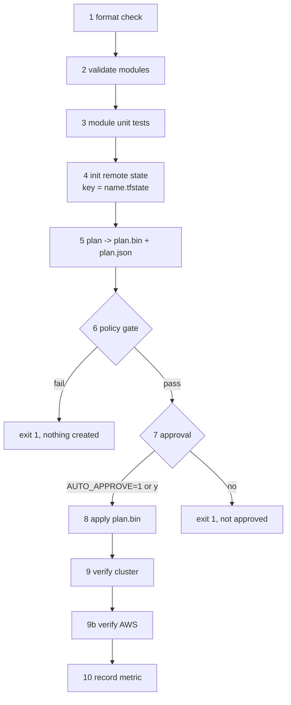

# 02 Delivery pipeline

**Status: the stages run locally through `scripts/ci.sh`, directly and through the job queue and worker. The GitHub Actions workflow (`.github/workflows/ci.yml`) is written but has never run; its plan and apply steps are placeholders. Real-AWS mode (`LOCAL=0`) is written and never run.**

## Architecture

## Who runs it

| How | Who | Mode |
|---|---|---|
| Console or API request | The worker claims a `create` or `fix` job, writes the request file, runs `scripts/ci.sh`, and writes the current stage into the database as it goes (`== N` lines) | `LOCAL=1` in local mode, `LOCAL=0` when `PLATFORM_MODE=aws` |
| Command line | You, with a request file | `LOCAL=1` default |
| GitHub Actions | Placeholder | not run |

Only one provisioning job runs at a time per queue, because the pipeline shares a working directory and Terraform lock. A failure at stage 6 or earlier is stored as `rejected` (nothing was created); later as `failed`.

## Local and real AWS

| | `LOCAL=1` (default) | `LOCAL=0` |
|---|---|---|
| Provider | LocalStack through `local/local.tfvars` | real AWS (`aws_local=false`) |
| State backend | `local/backend.hcl` | `TF_STATE_BUCKET`, `TF_LOCK_TABLE`, `AWS_REGION`, encrypted |
| Extra variables | none | `OIDC_PROVIDER_ARN`, `OIDC_ISSUER`, optional `PERMISSIONS_BOUNDARY_ARN` |
| AWS CLI in verify stages | `scripts/awslocal.sh` | `aws` (through `scripts/awscli.sh`) |
| Metric record | LocalStack bucket | shared database |
| Kubeconfig | `.local/kubeconfig` | `$KUBECONFIG`, written by `scripts/cluster-login.sh` |

## Flow: the ten stages

`scripts/ci.sh <request.tfvars>` stops at the first failing stage (`set -e`).

| Stage | What | Failure means |
|---|---|---|
| 1 | `tofu fmt -check` on modules, blueprints, bootstrap | Unformatted code |
| 2 | `tofu validate` per module | Invalid configuration, including input validation (for example a wildcard admin group is refused here) |
| 3 | `tofu test` per module (mocked providers) | A module regression |
| 4 | `tofu init` with the backend for the mode and a per-environment state key | Backend unreachable |
| 5 | `tofu plan -out=plan.bin`, then `show -json` | Provider or credential problem |
| 6 | `scripts/policy_check.py plan.json` | A policy rule is broken |
| 7 | Approval prompt; `AUTO_APPROVE=1` skips it for local runs | Not approved |
| 8 | `tofu apply plan.bin` (the reviewed plan, not a new one) | Apply error |
| 9, 9b | Cluster checks (10) and AWS checks (11) | Live state differs from the standard |
| 10 | Writes `{environment, elapsed_seconds, manual_steps, outcome}` to the metrics bucket (local) or the database (aws) | Metrics store unreachable |

Request time is taken when the script starts. Ready time is taken right after apply. The recorded figures are local timings, not production performance.

## Policy gate rules (stage 6)

Checked on the plan JSON, not on live state:

- Namespace exists and has `curve-metrics/team` and `curve-metrics/environment` labels.
- Resource quota exists with `requests.storage`, `persistentvolumeclaims` and `count/ingresses.networking.k8s.io` limits; a limit range exists.
- A `default-deny-ingress` network policy exists.
- Every S3 bucket has a public access block with all four settings on; SQS queues are encrypted; log groups have retention.
- IAM policies contain no wildcard action or resource (checked only when the policy text is known at plan time).
- No role binding to `cluster-admin`, and none to `system:authenticated` or `system:unauthenticated`.

14 unit tests cover the gate (`tests/test_policy_check.py`).

## Supporting flows

**Drift check** (`scripts/drift_check.sh <request>`): `tofu plan -detailed-exitcode` against live state. Exit 0 no drift, 2 drift, anything else the check itself failed.

**Hand change then repair:** someone edits an object by hand, the drift check reports it, and re-running the pipeline puts back everything the blueprint manages. Objects *added* by hand are not removed (see the limits in [03](03-compliance-spaces.md)).

**Rebuild:** `tofu destroy` then the pipeline again recreates the environment; checks pass. Secrets Manager keeps a destroyed secret in a recovery window, which blocks reusing the name until restored (also true on real AWS).

## Make targets

| Target | Does |
|---|---|
| `make ci-alpha` | Full pipeline, dev small, with `team-alpha-dev.tfvars` |
| `make ci-beta` | Full pipeline, prod large, two admin groups |
| `make ci-bad` | Must be rejected (wildcard admin); the target succeeds only if the pipeline fails |
| `make drift-alpha` | Drift check |
| `make demo-alpha` | Workload that writes to S3, sends to SQS, reads the secret, writes a log |
| `make netpol-alpha` | Proves the network policies actually block and allow traffic (with a control case) |

## The GitHub Actions definition

`ci.yml` has three jobs: `verify` (format, validate, module test, pytest), `plan` (pull requests only, placeholder), `apply` (push to `main`, behind the `production-approval` environment, placeholder). To make it real, supply cluster credentials from a secret store and the remote state backend, then run the plan per changed request file.

## Known limits

- Pipeline credentials: in the cloud design the worker gets them from Render's secret environment variables through an assume-only IAM user. A company secret store is not integrated.
- The approval stage is automatic in the worker (`AUTO_APPROVE=1`): the operator's request is the approval. There is no second reviewer on the console path. A real reviewer comes from GitHub's environment protection once that path is wired.
- The policy gate cannot see IAM policy text that depends on resources not yet created.
