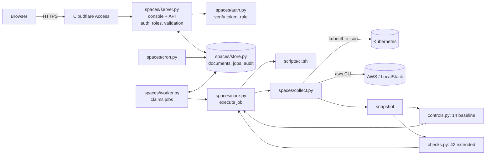
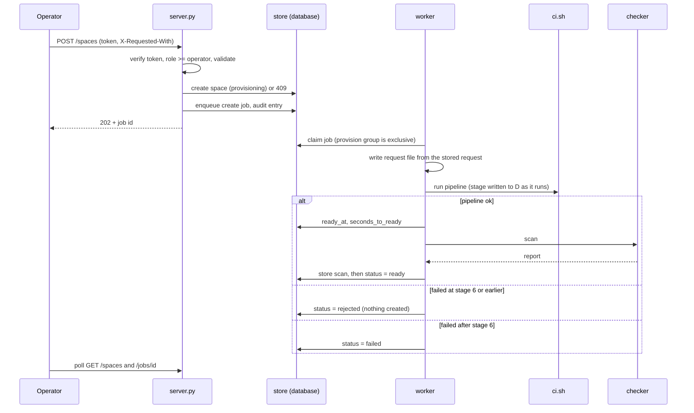
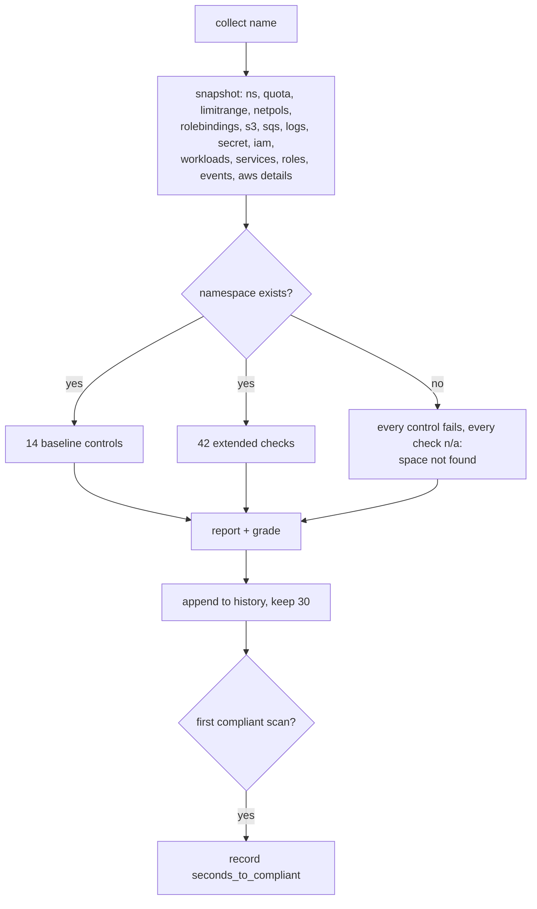

# 03 Compliance-Ready Spaces (the console)

**Status: built and tested locally (24 end-to-end checks through the queue and worker, 85 unit and HTTP tests). No company uses it. Local results only. Login, roles and the cloud services have never run for real.**

An operator requests a "space" (an environment) through the console or API. The delivery pipeline builds it. A checker reads the live state and scores it against 14 baseline controls and 42 extended checks, keeping a scan history. The console shows everything and is the place to scan, re-apply and run rollouts.

## Architecture

| File | Role |
|---|---|
| `spaces/server.py` | HTTP handler: login, roles, request validation, queueing, audit, security headers, static files. No cloud access |
| `spaces/auth.py` | Cloudflare Access token verification and role lookup |
| `spaces/config.py` | Settings from environment variables; refuses unsafe start-up |
| `spaces/store.py` | Documents, job queue, audit log on Postgres or SQLite |
| `spaces/worker.py` | Claims and runs jobs; also runs as a thread when `EMBEDDED_WORKER=1` |
| `spaces/core.py` | `validate`, `write_request`, `run_pipeline`, `scan`, `execute(job)` |
| `spaces/cron.py` | Queues a scan for every ready environment |
| `spaces/collect.py` | One snapshot: kubectl JSON plus AWS CLI calls in parallel; "not found" means absent; uses the read-only role when configured |
| `spaces/controls.py` | 14 pure baseline controls and `evaluate(snapshot)` |
| `spaces/checks.py` | 42 pure extended checks, severities, remediation, `grade` |
| `spaces/static/` | `index.html`, `app.js`, `app.css`: sidebar console, detail panel, request dialog, rollouts, activity |

## API and roles

See `docs/reference.md` for the full table. In short: viewers read, operators request and scan and preview, admins re-apply, roll out, replace the registry and read the audit log. Scans and builds are queued (`202` and a job id); `?wait=N` makes a scan synchronous for scripts. A second scan request for the same environment while one is queued returns the same job.

Input rules: `name` matches `^[a-z0-9]([-a-z0-9]{0,40}[a-z0-9])?$`, `team` matches `^[a-z0-9][-a-z0-9]{0,30}$`, size is one of the three presets, wildcard admin groups are refused by the pipeline.

## Flow: request an environment

Status becomes `ready` only after the first scan is stored. The browser never talks to the worker; both only share the database.

## Flow: a scan and the missing-space rule

The missing-space rule exists because several controls pass when there is nothing to object to; a deleted namespace must never score as compliant. A unit test caught this.

## The 14 baseline controls (decide `compliant`)

| ID | Checks | Source in snapshot |
|---|---|---|
| NET-1 | Default-deny ingress policy exists | network policies |
| NET-2 | No policy allows traffic from everywhere | network policies |
| ACC-1 | No wildcard subjects and no cluster-admin role bindings | role bindings |
| ACC-2 | Named admin groups present | role bindings |
| RES-1 | Quota matches the size preset | quota, namespace size label |
| RES-2 | Limit range present | limit range |
| OWN-1 | Ownership labels present | namespace |
| STO-1 | S3 public access fully blocked | S3 |
| STO-2 | S3 versioning enabled | S3 |
| STO-3 | S3 default encryption on | S3 |
| MSG-1 | SQS encrypted | SQS |
| LOG-1 | Log group has retention | logs |
| SEC-1 | Secret exists | Secrets Manager |
| SEC-2 | IAM policy has no wildcard action or resource | IAM |

## The 42 extended checks (severity-rated, never change `compliant`)

Each returns `pass`, `fail`, `na` (nothing to check, or the resource is missing and a baseline control already says so) or `unknown` (data could not be collected; never counted as a pass). A failure carries a severity (high, medium, low), evidence and a remediation hint.

| Area | IDs | Examples |
|---|---|---|
| Workload security | WLS-1 to 11 | privileged container, host network, hostPath, root user, dangerous capabilities, `:latest` image, literal secret in env, missing probe or limits |
| Exposure | NETX-1 to 4 | NodePort or LoadBalancer, ingress without TLS, `0.0.0.0/0` policy, no egress policy |
| Access | ACCX-1 to 4, PSA-1 | wildcard role, broad secret read, hand-made admin binding, cross-namespace service account, Pod Security Admission label |
| Drift | DRF-1 to 3 | unexpected network policy, service account without the role link, ConfigMap that no longer matches the real names |
| Runtime faults | RTH-1 to 8 | crash loop or image pull failure, pending pod, restarts, unavailable replicas, quota over 80%, unbound volume, warning events, failed jobs |
| AWS | S3X, SQSX, SECX, IAMX, LOGX | bucket policy TLS and open principal, tags, dead-letter queue, queue policy, secret rotation, role trust condition, extra or inline policies, service-wide wildcards, retention under 30 days |

`grade`: `non-compliant` if a baseline control fails; else `at risk` if a high finding is open; else `needs attention` if a medium is open; else `healthy`.

Several checks fail on a fresh environment because the blueprint does not yet do the thing: Pod Security Admission label, bucket TLS policy, dead-letter queue, secret rotation, egress policy. These are real gaps, shown rather than hidden. Thresholds (80% quota, 30 days, 5 restarts, 5 minutes pending) are the author's choices. Secrets are never read; only that the secret exists.

These are engineering controls and checks. Passing them does not make a space SOC 2, ISO or CIS compliant.

## The console

Environments (stat cards, search and filters, one row per environment with a 10-segment progress bar and health), a detail panel with Findings, Baseline, Pipeline and History tabs, a request dialog, Rollouts (pinned versions, preview, start, history), Activity (queue and audit log, admins), How it works. Light and dark mode by an icon toggle. Controls the signed-in role may not use are disabled or hidden; the server enforces the same rules.

## Test results

Local, 2026-11-06, after the move to queue and worker: 24 of 24 end-to-end checks pass (`docs/evidence/test-runs/spaces-e2e-queue-2026-11-06.txt`). Before it, on 2026-11-05: 24 of 24 (`spaces-e2e-first-run.txt`). 85 Python tests pass (`pytest-2026-11-06.txt`). Request to ready was about 49 s locally in the first run, a laptop figure, not a production one.

## Known limits

- Re-applying does not remove objects added by hand: a wildcard role binding is detected (ACC-1) but stays until someone deletes it.
- No per-team permissions: any operator can scan any environment.
- No retire action; no rate limit inside the app.
- LocalStack does not enforce IAM, so access controls are checked by configuration.
- Provisioning is one job at a time per queue.
- The job lease is a fixed time, not a heartbeat.
- Login, roles and the worker's cloud access have been tested with generated keys and containers, not with Cloudflare or AWS.
