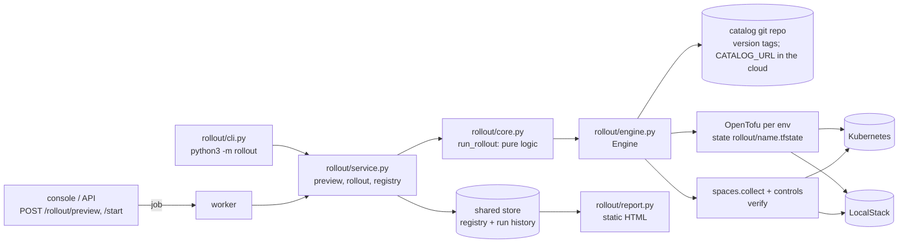
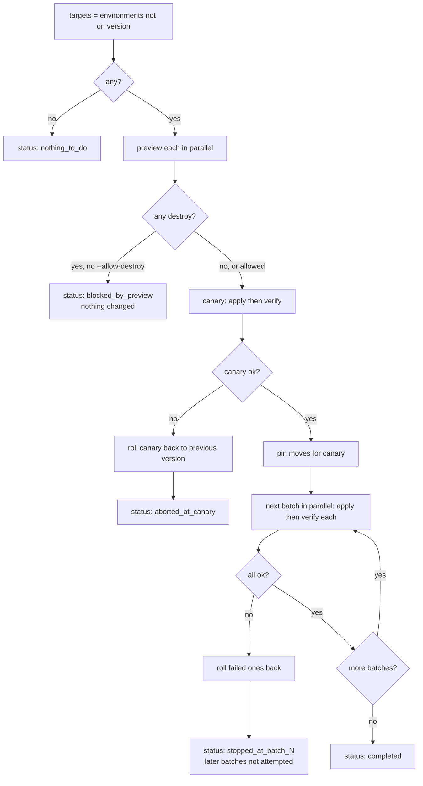
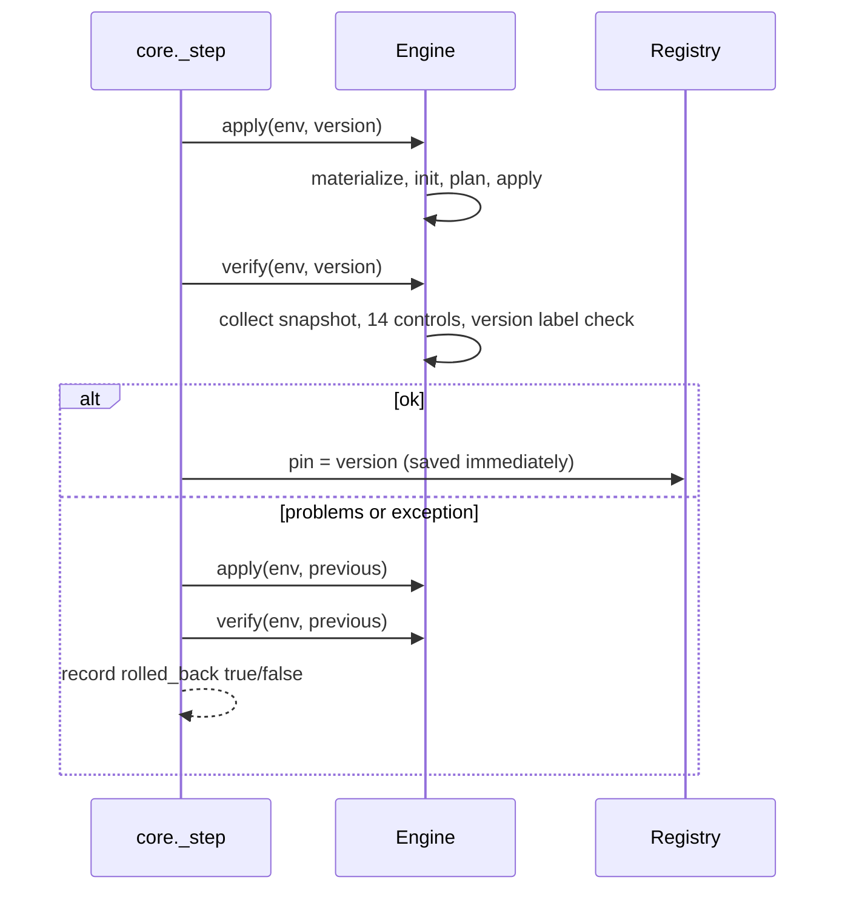

# 04 Blueprint Rollout Manager

**Status: built and tested locally. Starting and previewing a rollout from the console and API is built and unit tested, but the console path has not been run end to end against real clusters. No company uses it. The weekly GitHub workflow has never run.**

## The problem

The blueprint changes (a security rule, a new default). Every existing environment must follow. By hand that is partial or never done, and environments drift from the standard.

## Architecture

| File | Role |
|---|---|
| `rollout/service.py` | `preview`, `rollout`, registry read/write/validate, `pin_one`, `runs`, `versions`. Used by the worker, the CLI and the web API |
| `rollout/cli.py` | Commands; reads and writes the registry and runs through `service.py` |
| `rollout/core.py` | `run_rollout`, `pick_canaries`, `batches`, `_step`. No I/O of its own, so unit tested with a fake engine |
| `rollout/engine.py` | `materialize`, `plan`, `apply`, `actual_version`, `verify`, `destroy`, `purge_secret` |
| `rollout/catalog.py` | Builds the demo catalog with three releases; `sync_remote()` clones and fetches `CATALOG_URL` in the cloud |
| `rollout/report.py` | Static HTML report, escaped, dark and light theme |

Versions are git tags. `materialize` runs `git archive <tag> blueprints modules` into a fresh per-environment work dir and writes a `request.tfvars` including `extra_labels = {"curve-metrics/blueprint-version": "<tag>"}`. That label is how the live version is read back (`actual_version`).

## Commands

| Command | Does |
|---|---|
| `demo-registry [N]` | Build the demo catalog and a registry of N environments |
| `registry`, `registry-import FILE`, `last-run` | Print the registry, replace it from a JSON file, print the newest run |
| `provision` | Apply every environment at its pinned version (5 in parallel) |
| `status` | Pinned vs actual version and compliance per environment |
| `preview <v>` | Show add/change/destroy per environment; change nothing |
| `rollout <v> [--canary NAME] [--batch N] [--allow-destroy]` | The staged rollout below |
| `report [--live]` | Write `site/index.html` |
| `purge-secrets` | **Local demo only:** force-delete secrets so names can be reused |
| `destroy` | Destroy every environment |

## Flow: rollout to a new version

The canary is the environment flagged `canary` in the registry, else the first target, else the names given with `--canary`. Batch size defaults to 3, parallelism to 5.

## Flow: one environment step

A pin moves only after verification passes, so the registry never claims a version the environment does not run.

## Exit codes and statuses

`completed` and `nothing_to_do` exit 0. `blocked_by_preview`, `aborted_at_canary`, `stopped_at_batch_N` exit 1. Every run is stored in the shared database (namespace `rollout_run`); the registry is namespace `rollout_registry`. Nothing is kept in `.local/rollout/runs` any more.

## The demo catalog

| Tag | Content |
|---|---|
| v1.0.0 | Current blueprint |
| v1.1.0 | Log retention 30 to 90 days (an in-place change) |
| v1.2.0 | Removes the default-deny network policy (a deliberate regression) |

## Results (2026-11-05, local, one run each)

10 environments provisioned in 115 s; v1.1.0 rolled out to all in 198 s with each verified; v1.2.0 blocked by the preview without an override; with `--allow-destroy` the canary failed NET-1, rolled back, and the other 9 were untouched. Scripted clean run: 12 checks, 0 failed. Logs: `docs/evidence/test-runs/rollout-demo-run.txt`, `rollout-demo-script-run.txt`. Laptop timings with an emulator show the mechanism, not production speed.

## From the console and API

| Action | Role | What happens |
|---|---|---|
| Preview | operator | a `preview` job plans the version for every environment not on it and returns the changes and any destroys |
| Start rollout | admin | a `rollout` job runs the flow above; `409` if one is already queued or running |
| Replace registry | admin | `PUT /rollout/registry`, validated: each environment needs name, team, environment, size, admin_groups, version |

Preview and rollout share a job group, so they never overlap each other. In the cloud the worker needs `CATALOG_URL` (a git repository with `blueprints/` and `modules/` and version tags), a registry, and the real-AWS settings in `deploy/README.md`. Every start is written to the audit log.

## Concurrency details

OpenTofu `init` is serialized by a lock (shared plugin cache); verification is limited to 3 concurrent scans because each scan starts many short processes (docker runs locally, AWS CLI calls in the cloud).

## Known limits

- A failing **batch** (as opposed to a failing canary) is covered only by unit tests with a fake engine.
- Rollback re-applies the previous version. It cannot restore something applied outside the blueprint, or data in a destroyed resource.
- Parallel applies hit one cluster and one emulator; a larger fleet needs a concurrency limit tuned to the real cluster.
- `purge_secret` deliberately breaks the AWS recovery window and is for local use only. The module keeps the safe default.
- The weekly workflow `.github/workflows/rollout-demo.yml` has never run on GitHub; `scripts/local-up.sh` was tested only on macOS with Colima.
